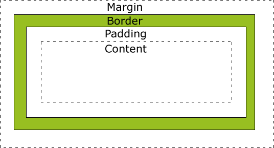

# HTML

## 整体结构

```
<!DOCTYPE html>
<meta http-equiv="Content-type" content="text/html;charset=UTF-8(编码格式)" />
<link rel="stylesheet" type="text/css" href="CSS外部样式表文件地址">
<script src="JS脚本地址"></script>
<html>
    <head>
        <title></title>
        <style>
            CSS选择器
        </style>
        ...
    </head>
    <body>
        ...
    </body>
</html>
```

# 标签<br>
标签有单个和一对的
1. 标题`<h1></h1>`，1~6
2. 段落`<p></p>`
3. 无序列
    ```
    <ul>
        <li></li>
    </ul>
    ```
4. 有序列
     ```
    <l>
        <li></li>
    </l>
    ```
5. 表格
    ```
    <table border="边框宽度">
        <tr>
            <th>列标题1</th>
            ...
        <tr>
        <tr>
            <td>列数据1</td>
            ...
        <tr>
    </table>
    ```
6. 按钮`<bottom></bottom>`
7. 表单<br>
    用户输入文本，单选多选等
    ```
    <form action="按下提交后表单内容发送到的服务器位置">
        <label for="对应input的id">(input元素定义标注)
        <input type="text/password(隐藏输入)/radio(单选)/checkbox(多选)/submit(提交)" placeholder="输入内容提示，输入就消失" value="text输入时已经固定的输入值或者按钮中显示的值" name="规定 <input>元素的名称，用以引用JavaScript中的元素，或在提交表单后引用表单数据">输入框后对应的值
    </form>
    ```
8. 其他
    ```
    <b>加粗</b>
    <i>斜体</i>
    <u>下划线</u>
    <s>删除线</s>
    <br>换行，可以写在任意文本中或标签之间
    <hr>分割线
    ```

## 属性<br>
1. 普适性属性`<标签 class="类" id="id" style="CSS的修饰">`
2. 链接`<a href="链接" target="新页面打开方式">文字，点击就会跳转</a>`
3. 图片``
4. 文字专有属性

## 区块<br>
1. 行内元素：可以与其他元素显示在同一行，占据的空间与其内容占据空间相关
2. 块元素：单占一行，可以手动调整大小，通过添加
3. 行内块元素：可以手动调整大小的行内元素

# CSS<br>
## 导入方式
1. 内联样式`<标签 style="属性名:属性值">
2. 内部样式表:写在style中的选择器
3. 外部样式表:写在外部CSS文件中的选择器，通过link标签导入
优先级:**内联>内部>外部**
## 选择器<br>
```
选择对象{
    属性名:属性值;
    ...
}
```
选择器选择优先级**id>类>标签**
1. 元素选择器`标签名{}`
2. 类选择器`.类名{}`
3. id选择器`#id{}`
4. 通用选择器`*{}`选择全体
5. 子代选择器`父代(可以用上述三个) > 子代{}`选择直接属于父代中的子代，比如
```
<div>
    <p></P>
</div>
```
6. 后代选择器`父代(可以用上述三个) 后代{}`选择不直接属于父代中的后代，比如
```
<div>
    <div>
        <p></P>
    </div>
</div>
```
7. 并集选择器`基准(可以用上述三个) + 对象{}`选择基准离最近的对象
8. 伪类选择器`对象(可以用上述三个):条件(伪类){}`选择满足条件的对象，比如条件用hover时会对鼠标悬停的对象起作用
9. 伪元素选择器`对象(可以用上述三个)::伪元素{}`选中对象的伪元素
## 属性<br>
下面叙述除了基本的属性以外的内容
1. 复合属性<br>
可以对属性设置多个值，设定属于该属性下不同属性的值`font:bolder 50px 'KaiTi'`
2. 块，行内，行内块元素相互转换`display:inline/block/inline-block`

## 盒子模型<br>
<br>
1. content:内容
2. padding:内容与边框的距离
3. border:边框
4. margin:边框与其他盒子的距离
<br>
padding,border,margin的属性设置中各个方向是复合属性，都是可以设定的，属性值按照上右下左，缺哪个会找对应另一边的

## 标准流，浮动，定位
1. 标准流<br>
html默认的排版
2. 浮动<br>
在父元素内相对标准流移动，具有行内块特性`float=left(左对齐)/right(右对齐)`，会脱离标准流，也就是不占正常位<br>
可用`overflow:hidden`或者使用伪元素选择器让父元素自适应宽高
3. 定位
    - 相对定位，相对于原本位置移动，不脱离标准流
    ```
    position:relative;
    left:   ;
    right:  ;
    top:    ;
    bottom: ;
    ```
    - 绝对定位，相对于父元素进行定位，脱离标准流`position:absolute`
    - 固定定位，相对于浏览器窗口定位，固定在视窗的某处，脱离标准流`position:fixed`
# JS<br>
包裹在写于body中的`<script></script>`中
## 输出<br>
1. 终端打印`console.log();`
2. 弹框`alert("")`
3. 带输入的弹框`prompt("")`返回值为输入内容
4. 将标签写到body里`document.write()`
## 变量
```
var a;//函数作用域，全局变量
let b=0/"char"/null;//限定范围作用域，只在所处{}/script中可用，局部变量
const pi=3.14;//常量
```
## 分支与循环
与C相同

## 函数
```
function name(参数){
    ...
    return   ；
}

//匿名函数，在用的时候才写
function(){}

//this作为函数实参表示函数触发时所在的位置
```
## 事件<br>

1. 常见事件

|事件|描述|
|---|---|
|onclick|点击|
|onmouseover|鼠标经过|
|onmouseout|鼠标移出|
|onchange|文本内容改变|
|onselect|文本框选中|
|onfocus|光标聚焦|
|onblur|移开光标|

<br>

2. 事件绑定<br>
    通过事件触发函数<br>
    1. html属性`<标签 事件(全小写)="函数名">`
    2. dom`变量.事件=函数名`
    3. addEventLIstener
    ```
    变量.addEventLIstener('事件',函数名,True/False)
    //最后的一个参数决定了事件传递方法
    //默认False冒泡(先触发子元素)，True捕获(先触发父元素)
    变量.removeEventListener('事件',函数名)
    ```

# DOM<br>
提供动态操作html结构的接口，每个html标签/属性/文本都是一个节点,最外部的是document
1. 获取元素`变量=document.getElementById/ClassName/Name/TagName(标签名)("")`返回存储着对应元素的数组
2. 修改内容
```
变量.innerHTML = "内容"//内容可以被HTML解读，也就是说可以传标签
变量.innerText = "内容"//内容只作为纯文本，不会被HTML解读
```
3. 常用方法<br>
    1. 创建标签节点`变量=document.createElement("p")`
    2. 创建文本节点`变量=document.createTextNode("文本")`
    3. 返回指定属性值`变量=变量.getAttribute("属性名")`

    4. appendChild()向某个节点添加文本/标签
    ```
    var para = document.createElement("p");
    var node = document.createTextNode("这是一个新的段落。");
    para.appendChild(node);
    var element = document.getElementById("div1");
    element.appendChild(para);
    ```
    <hr>

    5. removeChild()
    ```
    var parent = document.getElementById("div1");
    var child = document.getElementById("p1");
    parent.removeChild(child);
    ```
    <hr>

    6. replaceChild()
    ```
    var para = document.createElement("p");
    var node = document.createTextNode("这是一个新的段落。");
    para.appendChild(node);
    var parent = document.getElementById("div1");
    var child = document.getElementById("p1");
    parent.replaceChild(para, child);
    ```
    <hr>

    7. insertBefore()将新元素添加到前面
    ```
    var para = document.createElement("p");
    var node = document.createTextNode("这是一个新的段落。");
    para.appendChild(node);
    var element = document.getElementById("div1");
    var child = document.getElementById("p1");
    element.insertBefore(para, child);
    ```
    <hr>

# 移动端布局
1. viewport
`<meta name="viewport" content="width=device-width, initial-scale=1.0, minimum-sacle=1.0, maximum-scale=1.0", user-scalable=no>`<br>
`width=device-width`将视口宽度设置为设备宽度，确保网页不会被缩放<br>
`scale`将缩放比例固定在1<br>
`user-scalable=no`让用户无法缩放网页<br>
2. rem<br>
倍数单位，让显示自动根据初始值适配网页大小<br>
然后根据网页宽度自适应计算初始值<br>
```
<script>
function resetHTMLFontSize(){
    document.documentElement.style.fontSize = screen.size/10 + 'px'
}

resetHTMLFontSize();

windows.onresize=resetHTMLFontSize();
</script>
```
3. flex<br>
    子元素自适应排布的盒子(容器),可以设定如下的属性<br>
    1. flex-direction<br>
    决定主轴方向<br>
    `flex-direction = row(横轴左起点)/row-reverse(横轴右起点)/colume(纵轴上起点)/colume-reverse(纵轴下起点)`
    2. flex-wrap<br>
    当一条轴线摆不下时的换行方式<br>
    `flex-wrap = nowrap(不换行)/wrap/wrap-reverse`
    3. justify-content<br>
    与主轴对齐方式<br>
    `justify-content = flex-start(对齐起点)/flex-end(对齐终点)/center(对齐中点)/space-between(两侧对齐起点终点，等间距排开)/space-around(与起点终点有间隔，等间距排开)`
    4. align-items<br>
    与交叉轴(与主轴垂直)对齐方式<br>
    `align-items = flex-start(对齐起点)/flex-end(对齐终点)/center(对齐中点)/baselin(子元素的第一行文字基线对齐)/stretch(占满容器高度)`
    5. align-content<br>
    多根轴线的对齐方式<br>
    `justify-content = flex-start(对齐起点)/flex-end(对齐终点)/center(对齐中点)/space-between(两侧对齐起点终点，等间距排开)/space-around(与起点终点有间隔，等间距排开)/stretch(占满容器高度)`
